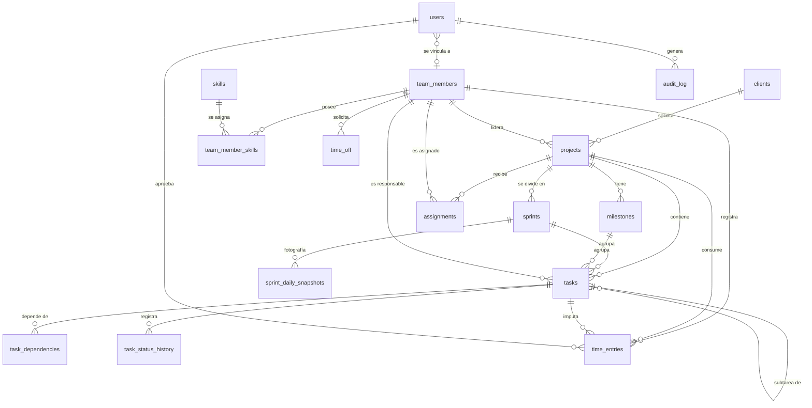

# Modelo de datos — DevPM

Especificación de entidades, atributos, relaciones, restricciones e índices de la base de datos
SQLite. Es la referencia para escribir las migraciones en `src/db/migrations/`.

---

## 1. Convenciones

| Tema | Regla |
|---|---|
| Nombres | Tablas en plural `snake_case` (`team_members`); columnas `snake_case`; FK como `<entidad>_id` |
| Llave primaria | `id INTEGER PRIMARY KEY` (alias de `rowid`, autoincremental) |
| Fechas de calendario | `TEXT` `YYYY-MM-DD` con `CHECK (col IS date(col))` |
| Marcas de tiempo | `TEXT` UTC ISO-8601 `YYYY-MM-DDTHH:MM:SS.SSSZ`, por defecto `strftime('%Y-%m-%dT%H:%M:%fZ','now')` |
| Duraciones | `INTEGER` en **minutos** (`*_minutes`) |
| Dinero | `INTEGER` en **centavos** (`*_cents`) + `currency TEXT` ISO-4217 |
| Booleanos | `INTEGER` `0/1` con `CHECK (col IN (0,1))` |
| Enumeraciones | `TEXT` con `CHECK (col IN (...))` |
| Auditoría de fila | `created_at`, `updated_at` en todas las tablas de negocio; `updated_at` lo asigna el repository |
| Borrado | Lógico con `is_active` en catálogos; físico solo sin dependencias |
| Integridad | `PRAGMA foreign_keys = ON`; acciones `ON DELETE` explícitas en cada FK |

Abreviaturas en las tablas: **PK** llave primaria, **FK** llave foránea, **NN** not null,
**UQ** único, **CK** check.

## 2. Diagrama entidad-relación



## 3. Entidades

### 3.1 `users` — Usuarios del sistema

| Columna | Tipo | Restricciones | Descripción |
|---|---|---|---|
| id | INTEGER | PK | |
| email | TEXT | NN, UQ (`COLLATE NOCASE`) | Usuario de inicio de sesión |
| password_hash | TEXT | NN | bcrypt |
| full_name | TEXT | NN | |
| role | TEXT | NN, CK `admin`,`pm`,`developer`,`viewer` | Ver PRD §4 |
| team_member_id | INTEGER | FK → team_members(id) `ON DELETE SET NULL`, UQ | Vinculación para registrar su tiempo (RF-04) |
| is_active | INTEGER | NN, default 1 | |
| last_login_at | TEXT | | |
| created_at / updated_at | TEXT | NN | |

### 3.2 `clients` — Clientes internos y externos

Una sola tabla con discriminador `type`. Las columnas propias de cada tipo se validan con `CHECK`.

| Columna | Tipo | Restricciones | Descripción |
|---|---|---|---|
| id | INTEGER | PK | |
| type | TEXT | NN, CK `internal`,`external` | Discriminador |
| name | TEXT | NN | Nombre visible (departamento o nombre comercial) |
| contact_name | TEXT | | Responsable / contacto principal |
| contact_email | TEXT | | |
| contact_phone | TEXT | | |
| **Internos** | | | |
| department | TEXT | NN si `type='internal'` | Área solicitante |
| cost_center | TEXT | | Centro de costos |
| **Externos** | | | |
| legal_name | TEXT | NN si `type='external'` | Razón social |
| tax_id | TEXT | UQ (si no es nulo) | RFC / ID fiscal |
| hourly_rate_cents | INTEGER | NN si `type='external'`, ≥ 0 | Tarifa por hora |
| currency | TEXT | default `'MXN'` | ISO-4217 |
| address | TEXT | | |
| **Comunes** | | | |
| is_active | INTEGER | NN, default 1 | RF-18: desactivar en vez de borrar |
| notes | TEXT | | |
| created_at / updated_at | TEXT | NN | |

```sql
CHECK (
  (type = 'internal' AND department IS NOT NULL)
  OR (type = 'external' AND legal_name IS NOT NULL AND hourly_rate_cents IS NOT NULL)
)
```

### 3.3 `team_members` — Equipo de desarrollo

| Columna | Tipo | Restricciones | Descripción |
|---|---|---|---|
| id | INTEGER | PK | |
| first_name / last_name | TEXT | NN | |
| email | TEXT | NN, UQ (`COLLATE NOCASE`) | |
| position | TEXT | NN, CK `frontend`,`backend`,`fullstack`,`qa`,`devops`,`designer`,`pm` | Puesto |
| seniority | TEXT | NN, CK `junior`,`mid`,`senior`,`lead` | |
| weekly_capacity_minutes | INTEGER | NN, default 2400, CK 0–4800 | 2400 = 40 h |
| hourly_cost_cents | INTEGER | NN, default 0, ≥ 0 | Costo interno |
| hire_date | TEXT | fecha | |
| is_active | INTEGER | NN, default 1 | |
| created_at / updated_at | TEXT | NN | |

### 3.4 `skills` y `team_member_skills`

`skills`: `id` PK, `name` TEXT NN UQ (`COLLATE NOCASE`), `category` TEXT (`language`, `framework`, `tool`, `soft`).

`team_member_skills`:

| Columna | Tipo | Restricciones |
|---|---|---|
| team_member_id | INTEGER | FK → team_members `ON DELETE CASCADE` |
| skill_id | INTEGER | FK → skills `ON DELETE CASCADE` |
| level | INTEGER | NN, CK 1–5 |
| | | PK (`team_member_id`, `skill_id`) |

### 3.5 `time_off` — Ausencias

| Columna | Tipo | Restricciones | Descripción |
|---|---|---|---|
| id | INTEGER | PK | |
| team_member_id | INTEGER | NN, FK → team_members `ON DELETE CASCADE` | |
| type | TEXT | NN, CK `vacation`,`sick`,`personal`,`holiday` | |
| start_date / end_date | TEXT | NN, fechas, CK `end_date >= start_date` | Inclusivas |
| notes | TEXT | | |
| created_at / updated_at | TEXT | NN | |

**Regla de traslape (decisión):** se permite guardar ausencias del mismo miembro con periodos
traslapados (inclusivos), pero la respuesta incluye una advertencia `TIME_OFF_OVERLAP` con los ids
que se traslapan (equivalente a la advertencia de sobreasignación RF-41). El cálculo de capacidad
debe contar cada día de ausencia una sola vez.

### 3.6 `projects` — Proyectos

| Columna | Tipo | Restricciones | Descripción |
|---|---|---|---|
| id | INTEGER | PK | |
| code | TEXT | NN, UQ | Ej. `PRJ-2026-001` |
| name | TEXT | NN | |
| description | TEXT | | |
| client_id | INTEGER | NN, FK → clients `ON DELETE RESTRICT` | RF-18 |
| manager_id | INTEGER | FK → team_members `ON DELETE SET NULL` | Líder |
| status | TEXT | NN, default `planning`, CK `planning`,`active`,`on_hold`,`completed`,`cancelled` | |
| priority | TEXT | NN, default `medium`, CK `low`,`medium`,`high`,`critical` | |
| methodology | TEXT | NN, default `scrum`, CK `scrum`,`kanban`,`waterfall` | |
| start_date | TEXT | NN, fecha | Inicio planeado |
| end_date | TEXT | NN, fecha, CK `end_date >= start_date` | Fin planeado |
| actual_start_date / actual_end_date | TEXT | fecha | Reales |
| budget_minutes | INTEGER | NN, default 0, ≥ 0 | Presupuesto en horas (para SPI/CPI) |
| budget_cents | INTEGER | ≥ 0 | Presupuesto monetario |
| is_billable | INTEGER | NN | Default según tipo de cliente (RF-34), lo asigna el service |
| created_at / updated_at | TEXT | NN | |

**Transiciones de estado válidas** (validadas en el service):

```
planning ──► active ──► completed
   │           │ ▲
   │           ▼ │
   │         on_hold
   └──────────┴───────► cancelled
```

- `planning → active` asigna `actual_start_date` = hoy si es nulo.
- `active → completed` exige que no haya tareas abiertas (o confirmación explícita) y asigna `actual_end_date`.
- `completed` y `cancelled` son finales.

### 3.7 `milestones` — Hitos

| Columna | Tipo | Restricciones |
|---|---|---|
| id | INTEGER | PK |
| project_id | INTEGER | NN, FK → projects `ON DELETE CASCADE` |
| name | TEXT | NN |
| description | TEXT | |
| due_date | TEXT | NN, fecha |
| status | TEXT | NN, default `pending`, CK `pending`,`completed`,`missed` |
| completed_at | TEXT | |
| created_at / updated_at | TEXT | NN |

### 3.8 `assignments` — Asignaciones de miembros a proyectos

| Columna | Tipo | Restricciones | Descripción |
|---|---|---|---|
| id | INTEGER | PK | |
| project_id | INTEGER | NN, FK → projects `ON DELETE CASCADE` | |
| team_member_id | INTEGER | NN, FK → team_members `ON DELETE RESTRICT` | |
| project_role | TEXT | NN | Ej. "Backend líder", "QA" |
| allocation_percent | INTEGER | NN, CK 1–100 | Dedicación |
| start_date / end_date | TEXT | NN, fechas, CK `end_date >= start_date` | Dentro del rango del proyecto (validado en service) |
| created_at / updated_at | TEXT | NN | |

Regla RF-41 (service): para el miembro, `SUM(allocation_percent)` de asignaciones cuyo periodo
se traslapa (`a.start_date <= :end AND a.end_date >= :start`) no debería exceder 100. Si excede,
se guarda igualmente pero la respuesta incluye `warnings: ['OVER_ALLOCATION']`.

### 3.9 `sprints`

| Columna | Tipo | Restricciones | Descripción |
|---|---|---|---|
| id | INTEGER | PK | |
| project_id | INTEGER | NN, FK → projects `ON DELETE CASCADE` | |
| name | TEXT | NN | Ej. "Sprint 4" |
| goal | TEXT | | Objetivo |
| start_date / end_date | TEXT | NN, fechas, CK `end_date >= start_date` | |
| status | TEXT | NN, default `planned`, CK `planned`,`active`,`closed` | |
| committed_points | INTEGER | | Se fija al iniciar el sprint (K9) |
| completed_points | INTEGER | | Se fija al cerrar el sprint (K8) |
| created_at / updated_at | TEXT | NN | |

Índice único parcial: un solo sprint activo por proyecto (RF-60).

```sql
CREATE UNIQUE INDEX ux_sprints_one_active ON sprints(project_id) WHERE status = 'active';
```

### 3.10 `tasks` — Tareas

| Columna | Tipo | Restricciones | Descripción |
|---|---|---|---|
| id | INTEGER | PK | |
| project_id | INTEGER | NN, FK → projects `ON DELETE CASCADE` | |
| sprint_id | INTEGER | FK → sprints `ON DELETE SET NULL` | Nulo = backlog |
| milestone_id | INTEGER | FK → milestones `ON DELETE SET NULL` | |
| parent_task_id | INTEGER | FK → tasks `ON DELETE CASCADE` | Subtareas (RF-65) |
| title | TEXT | NN | |
| description | TEXT | | |
| type | TEXT | NN, default `feature`, CK `feature`,`bug`,`chore`,`spike` | |
| status | TEXT | NN, default `backlog`, CK `backlog`,`todo`,`in_progress`,`in_review`,`done`,`blocked` | |
| priority | TEXT | NN, default `medium`, CK `low`,`medium`,`high`,`critical` | |
| story_points | INTEGER | CK `IN (0,1,2,3,5,8,13,21)` | Fibonacci |
| estimated_minutes | INTEGER | ≥ 0 | |
| assignee_id | INTEGER | FK → team_members `ON DELETE SET NULL` | Debe estar asignado al proyecto (RF-42) |
| start_date / due_date | TEXT | fechas, CK `due_date >= start_date` | Para Gantt |
| started_at | TEXT | | Primera vez en `in_progress` (K12) |
| completed_at | TEXT | | Al pasar a `done`; se limpia si se reabre |
| sort_order | INTEGER | NN, default 0 | Orden en backlog/Kanban |
| created_at / updated_at | TEXT | NN | |

### 3.11 `task_dependencies`

| Columna | Tipo | Restricciones |
|---|---|---|
| task_id | INTEGER | FK → tasks `ON DELETE CASCADE` (tarea sucesora) |
| depends_on_task_id | INTEGER | FK → tasks `ON DELETE CASCADE` (predecesora) |
| type | TEXT | NN, default `FS`, CK `FS` (fin-a-inicio; extensible) |
| | | PK (`task_id`, `depends_on_task_id`), CK `task_id <> depends_on_task_id` |

Regla (service): ambas tareas del mismo proyecto y **sin ciclos** (búsqueda recursiva con
`WITH RECURSIVE` antes de insertar).

### 3.12 `task_status_history`

| Columna | Tipo | Restricciones |
|---|---|---|
| id | INTEGER | PK |
| task_id | INTEGER | NN, FK → tasks `ON DELETE CASCADE` |
| from_status | TEXT | (nulo al crear) |
| to_status | TEXT | NN |
| changed_by | INTEGER | FK → users `ON DELETE SET NULL` |
| changed_at | TEXT | NN |

Se inserta en la misma transacción que el cambio de estado. Base para cycle time (K12) y
reconstrucción de burndown si faltaran instantáneas.

### 3.13 `time_entries` — Registro de tiempo

| Columna | Tipo | Restricciones | Descripción |
|---|---|---|---|
| id | INTEGER | PK | |
| team_member_id | INTEGER | NN, FK → team_members `ON DELETE RESTRICT` | |
| project_id | INTEGER | NN, FK → projects `ON DELETE RESTRICT` | |
| task_id | INTEGER | FK → tasks `ON DELETE SET NULL` | Opcional; si existe, mismo proyecto |
| work_date | TEXT | NN, fecha | No futura (RF-53) |
| minutes | INTEGER | NN, CK `minutes > 0 AND minutes <= 1440` | |
| description | TEXT | NN | |
| is_billable | INTEGER | NN | Hereda de `projects.is_billable` (RF-54) |
| status | TEXT | NN, default `draft`, CK `draft`,`submitted`,`approved`,`rejected` | RF-52 |
| approved_by | INTEGER | FK → users `ON DELETE SET NULL` | |
| approved_at | TEXT | | |
| rejection_reason | TEXT | | Obligatorio si `rejected` |
| created_at / updated_at | TEXT | NN | |

Reglas (service): el miembro debe tener asignación vigente en el proyecto para `work_date`;
la suma diaria por miembro ≤ 1440 minutos; solo `draft`/`rejected` son editables por el autor.

### 3.14 `sprint_daily_snapshots` — Datos del Burndown

| Columna | Tipo | Restricciones | Descripción |
|---|---|---|---|
| sprint_id | INTEGER | FK → sprints `ON DELETE CASCADE` | |
| snapshot_date | TEXT | NN, fecha | |
| total_points | INTEGER | NN | Alcance del sprint ese día |
| completed_points | INTEGER | NN | Puntos `done` |
| remaining_points | INTEGER | NN | `total - completed` |
| remaining_minutes | INTEGER | NN | Estimado restante (RF-83) |
| captured_at | TEXT | NN | Última actualización |
| | | PK (`sprint_id`, `snapshot_date`) | Permite *upsert* idempotente |

Cambio de alcance del día (RF-82) = `total_points(d) − total_points(d−1)`.

### 3.15 `audit_log`

| Columna | Tipo | Restricciones |
|---|---|---|
| id | INTEGER | PK |
| user_id | INTEGER | FK → users `ON DELETE SET NULL` |
| entity | TEXT | NN (nombre de tabla) |
| entity_id | INTEGER | NN |
| action | TEXT | NN, CK `create`,`update`,`delete`,`status_change` |
| changes | TEXT | JSON `{campo: [antes, después]}`, CK `json_valid(changes)` |
| created_at | TEXT | NN |

### 3.16 Tablas de soporte

| Tabla | Propósito |
|---|---|
| `settings` | `key TEXT PK`, `value TEXT` (JSON). Umbrales de KPIs (RF-93), zona horaria, días hábiles |
| `sessions` | Creada en la migración `003_sessions.sql` y gestionada por el store propio de `express-session` (`sid` PK, `sess` JSON, `expires_at` en ms epoch, índice por `expires_at`) |
| `schema_migrations` | `version TEXT PK`, `applied_at TEXT` — control del runner de migraciones |

## 4. Índices

Además de PK y UQ:

```sql
CREATE INDEX ix_clients_type_active        ON clients(type, is_active);
CREATE INDEX ix_projects_client            ON projects(client_id);
CREATE INDEX ix_projects_manager           ON projects(manager_id);
CREATE INDEX ix_projects_status            ON projects(status);
CREATE INDEX ix_milestones_project_due     ON milestones(project_id, due_date);
CREATE INDEX ix_assignments_member_period  ON assignments(team_member_id, start_date, end_date);
CREATE INDEX ix_assignments_project        ON assignments(project_id);
CREATE INDEX ix_sprints_project_status     ON sprints(project_id, status);
CREATE INDEX ix_tasks_project_status       ON tasks(project_id, status);
CREATE INDEX ix_tasks_sprint_status        ON tasks(sprint_id, status);
CREATE INDEX ix_tasks_assignee_status      ON tasks(assignee_id, status);
CREATE INDEX ix_tasks_due                  ON tasks(due_date) WHERE status <> 'done';
CREATE INDEX ix_task_history_task          ON task_status_history(task_id, changed_at);
CREATE INDEX ix_time_member_date           ON time_entries(team_member_id, work_date);
CREATE INDEX ix_time_project_date          ON time_entries(project_id, work_date);
CREATE INDEX ix_time_status                ON time_entries(status);
CREATE INDEX ix_time_off_member            ON time_off(team_member_id, start_date, end_date);
CREATE INDEX ix_audit_entity               ON audit_log(entity, entity_id);
```

## 5. Vistas para KPIs

Las vistas encapsulan agregaciones reutilizables. Los filtros de fecha se aplican en la
consulta que las usa.

```sql
-- Avance y consumo por proyecto (K2, K3, K4, K5)
CREATE VIEW v_project_progress AS
SELECT
  p.id                                                             AS project_id,
  p.status, p.start_date, p.end_date, p.budget_minutes,
  COALESCE(SUM(t.story_points), 0)                                 AS total_points,
  COALESCE(SUM(CASE WHEN t.status = 'done' THEN t.story_points END), 0) AS done_points,
  (SELECT COALESCE(SUM(te.minutes), 0) FROM time_entries te
     WHERE te.project_id = p.id AND te.status IN ('submitted','approved')) AS spent_minutes
FROM projects p
LEFT JOIN tasks t ON t.project_id = p.id AND t.parent_task_id IS NULL
GROUP BY p.id;

-- Dedicación asignada por miembro (K7) — se filtra por periodo en la consulta
CREATE VIEW v_member_allocations AS
SELECT a.team_member_id, a.project_id, a.allocation_percent, a.start_date, a.end_date
FROM assignments a
JOIN projects p ON p.id = a.project_id
WHERE p.status IN ('planning','active');

-- Horas por miembro, proyecto, día y tipo de cliente (K6, K13, K14, K16)
CREATE VIEW v_time_by_client_type AS
SELECT te.work_date, te.team_member_id, te.project_id, te.minutes, te.is_billable, te.status,
       c.id AS client_id, c.type AS client_type, c.hourly_rate_cents, c.currency
FROM time_entries te
JOIN projects p ON p.id = te.project_id
JOIN clients  c ON c.id = p.client_id;
```

Cálculos derivados en `kpi.service.js` (fórmulas de PRD §6):

```
avance        = done_points / total_points
pct_tiempo    = clamp((hoy − start_date) / (end_date − start_date), 0, 1)
EV            = avance × budget_minutes
PV            = pct_tiempo × budget_minutes
AC            = spent_minutes
SPI           = EV / PV        (null si PV = 0)
CPI           = EV / AC        (null si AC = 0)
consumo       = AC / budget_minutes
```

## 6. Ciclo de vida de los datos

| Evento | Efecto en datos |
|---|---|
| Crear proyecto | `is_billable` = (`client.type = 'external'`); `audit_log` |
| Iniciar sprint | `status='active'`, `committed_points` = Σ puntos del sprint; snapshot día 0 |
| Cambiar estado de tarea | `task_status_history`; `started_at` / `completed_at`; upsert snapshot de hoy si su sprint está activo |
| Cerrar sprint | `completed_points`; tareas abiertas → backlog (`sprint_id = NULL`) o al sprint siguiente |
| Aprobar horas | `status='approved'`, `approved_by`, `approved_at` |
| Desactivar cliente/miembro | `is_active = 0`; no aparece en selectores, conserva historial |

## 7. Datos semilla (desarrollo)

`npm run db:seed` crea un conjunto coherente para probar todas las vistas:

- 1 usuario por rol (`admin@devpm.local`, `pm@devpm.local`, `dev@devpm.local`, `viewer@devpm.local`; contraseña `Cambiar123!`).
- 3 clientes internos (TI, Finanzas, Recursos Humanos) y 3 externos con tarifas distintas.
- 10 miembros del equipo con skills; 2 con ausencias en el mes actual.
- 6 proyectos en distintos estados, uno deliberadamente en riesgo (fecha vencida) y uno con un miembro sobreasignado.
- Sprints (uno activo por proyecto Scrum activo) con ~15 tareas cada uno, dependencias y fechas.
- Registros de tiempo de las últimas 6 semanas en todos los estados.
- Instantáneas de burndown de los días transcurridos del sprint activo.
